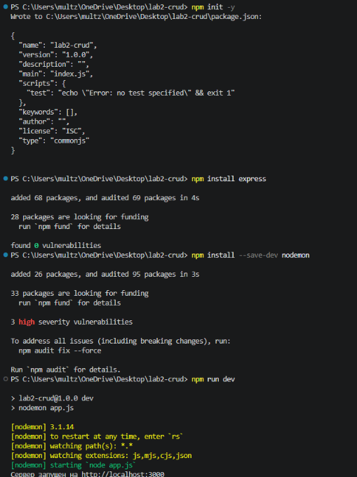
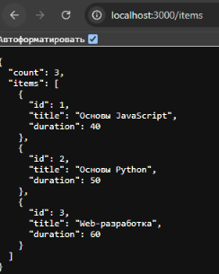
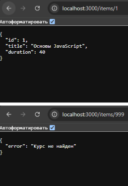
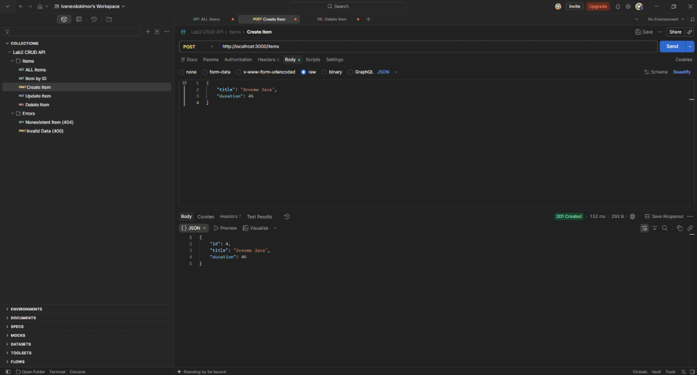
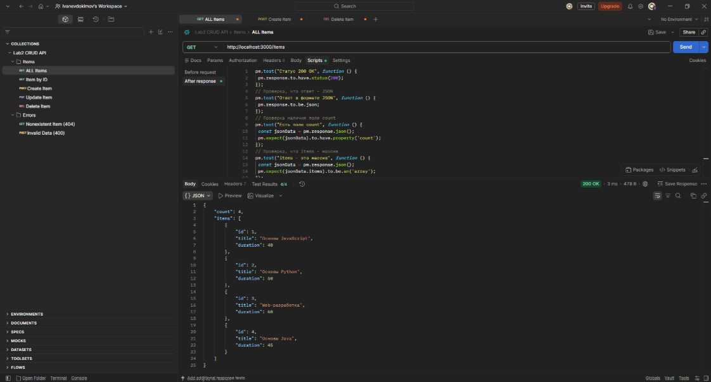
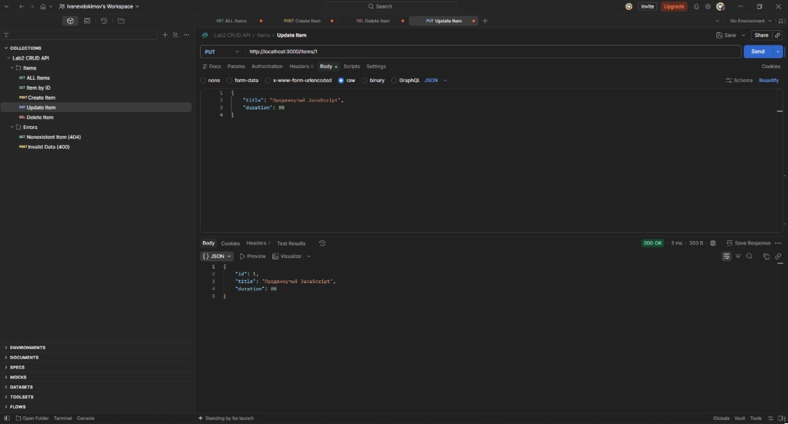
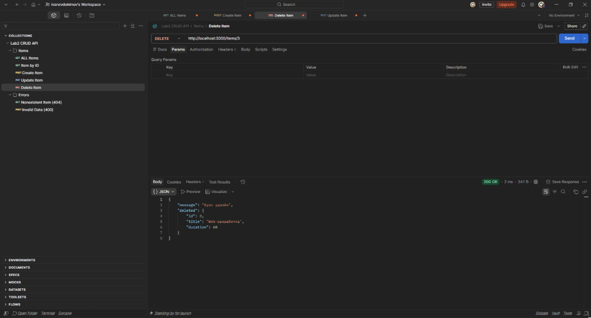
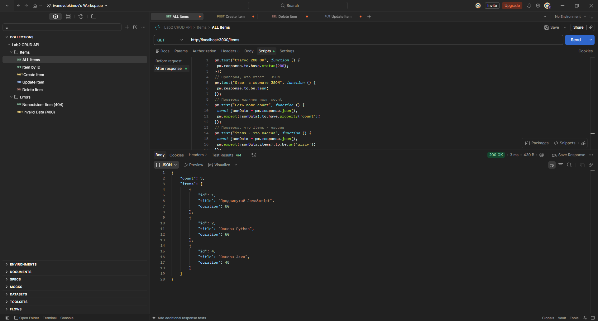

https://github.com/NXGHTMXRE007/lab2-crud

# Лабораторная работа №2: HTTP-методы: обработка GET, POST, PUT, DELETE

**Студент:** Евдокимов Иван Александрович
**Группа:** ПИЖ-б-о-25-2(1)
**Вариант:** 9

## Цель работы
Освоить обработку различных HTTP-методов (GET, 
POST, PUT, DELETE) в Express/Flask. Научиться реализовывать CRUD
операции над коллекцией объектов, хранящейся в памяти сервера, а также 
возвращать корректные HTTP-коды ответов (200, 201, 404).


## Выполнение практического  задания

















```bash
Контрольные вопросы
Базовый уровень
1. Что такое CRUD? Расшифруйте каждую букву.
CRUD — акроним для базовых операций с данными: Create (создать), Read (прочесть), Update (обновить), Delete (удалить).
1. Какие HTTP-методы соответствуют операциям CRUD?
Create — POST, Read — GET, Update — PUT/PATCH, Delete — DELETE.
1. Что такое идемпотентность HTTP-методов? Какие методы идемпотентны?
Это свойство, при котором повторный запрос не меняет состояние сервера; идемпотентны GET, PUT, DELETE, HEAD, OPTIONS.
1. Какой код ответа возвращается при успешном создании ресурса (POST)?
Статус-код 201 Created.
1. Какой код ответа возвращается при успешном удалении ресурса?
Обычно возвращается статус-код 204 No Content или 200 OK.
1. Что такое middleware в Express? Для чего используется express.json()?
Это функции-посредники для обработки запроса до контроллера; express.json() парсит входящий JSON в объект req.body.
1. Как получить параметры из тела POST-запроса в Express?
Через свойство req.body.
1. Как получить параметр из URL (например, ID)?
Через объект параметров маршрута req.params.id.
1. Как найти элемент в массиве по ID?
С помощью встроенного метода array.find(item => item.id === id).
1.  Какой код ответа возвращается, если ресурс не найден?
Статус-код 404 Not Found.
1.  Как отправить JSON-ответ в Express?
С помощью метода res.json(data).
1.  Как вернуть статус-код 201 в Express?
Используя цепочку методов res.status(201).json(data).
1.  Что произойдёт с данными в памяти при перезапуске сервера?
Все данные в оперативной памяти будут полностью стерты.
1.  Как добавить новый элемент в массив?
С помощью метода array.push(item) или деструктуризации [...array, item].
1.  Как удалить элемент из массива?
С помощью метода фильтрации array.filter(item => item.id !== id) или array.splice().


Средний уровень
1. В чём разница между PUT и PATCH?
PUT перезаписывает ресурс целиком, а PATCH обновляет только переданные частичные поля.
2. Как реализовать поиск по коллекции (query-параметр search)?
Отфильтровать массив через array.filter(), проверяя вхождение строки из req.query.search.
3. Как реализовать сортировку по полю?
Передать функцию сравнения по нужному полю из req.query в метод array.sort().
4. Как реализовать пагинацию (постраничный вывод)?
Вырезать нужную порцию массива с помощью array.slice(offset, offset + limit) на основе req.query.
5. Как валидировать входные данные (например, что price — число)?
Проверкой typeof price === 'number' или с помощью библиотек валидации вроде Zod или Joi.
6. Какие коды ответов используются при ошибках валидации?
Статус-коды 400 Bad Request или 422 Unprocessable Entity.
7. Как вернуть 204 No Content при DELETE?
Вызвать метод отправки статуса res.sendStatus(204).
8. В чём разница между res.json() и res.send()?
res.json() принудительно конвертирует данные в JSON-строку, а res.send() принимает любые типы данных и автоматически определяет тип контента.
9. Как избежать дублирования ID при создании новых элементов?
Использовать генераторы уникальных идентификаторов, например crypto.randomUUID() или библиотеку uuid.
10. Что такое express.json() и почему без него req.body пустой?
Это middleware для чтения сырых байт потока запроса; без него Node.js не знает, как превратить входящий текст в JS-объект.


Продвинутый уровень
1. Как реализовать частичное обновление (PATCH)?
Найти объект в массиве и применить к нему изменения с помощью Object.assign(target, req.body).
2. Как реализовать массовое удаление элементов?
Отфильтровать коллекцию, исключив все элементы, чьи ID входят в пришедший массив: array.filter(el => !ids.includes(el.id)).
3. Как реализовать массовое создание элементов?
Пройтись по массиву объектов из req.body, добавить каждому ID и запушить в основную коллекцию через array.push(...newItems).
4. Как реализовать глобальный обработчик ошибок?
Создать в конце всех маршрутов middleware-функцию с 4 аргументами: app.use((err, req, res, next) => { ... }).
5. Как логировать запросы в файл?
Использовать встроенный модуль fs.appendFile() или готовые библиотеки логирования, такие как Winston или Morgan.
6. Что такое REST API и какие принципы лежат в его основе?
Это стиль архитектуры API, основанный на принципах Stateless, Client-Server, Cacheable, Uniform Interface, Layered System.
7. Как организовать структуру проекта для масштабируемого CRUD API?
Разделить код по слоям на папки: routes (маршруты), controllers (транспорт), services (бизнес-логика) и models (данные).
8. Какие существуют стратегии генерации уникальных ID?
Использование UUID / ULID / CUID, автоинкремент в реляционных БД или генерация ObjectId в NoSQL (MongoDB).
9. Как защитить API от слишком больших запросов?
Задать лимит в настройках middleware: express.json({ limit: '10kb' }) и подключить защиту от спама запросами express-rate-limit.
10. Как реализовать связь между сущностями (например, задачи и пользователи)?
Сохранять идентификатор создателя в объекте задачи в виде внешнего ключа (например, userId: 123).

```